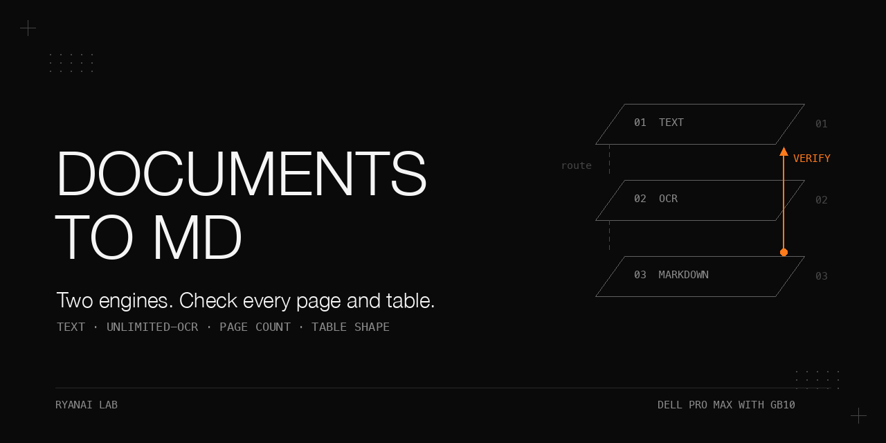

# Any document to Markdown on a Dell Pro Max with GB10

> Two engines, one routing rule, and a converter that reports what it could not convert.
> A text extractor can return success while losing a scanned page; an OCR model can return success while losing table columns or almost an entire document.
> This cookbook routes by text-layer density, then checks the result before publishing it.
> Its central evidence is a synthetic OCR measurement on 2026-10-04: per-page inference within one model load recovered the tested tables correctly, while a multi-page call silently degraded.

## Why this matters

A successful process is not evidence of a complete document.
On generated inputs, markitdown returned exit code 0 for an image-only PDF with one byte of output.
On the newer OCR benchmark, every run exited 0 and printed its completion sentinel.
At 10 pages, all page markers survived but tables were damaged; at 40 pages, only one page block survived.

The design recommended here is **per-page OCR within one model load, a recovered-page-count check that fails loudly, and a table-shape check**.
On the synthetic 10-page comparison, that cost about 15% more OCR time per page: 8.61 s against 7.50 s.
The per-page result was observed once; it is not a guarantee for other layouts or longer documents.

## What is in this book

- [One engine is the wrong bet](docs/engines.md): distinguish text extraction, visual recovery, and structural correctness.
- [The OCR container](docs/container.md): reconstruct the dependency fixes and pin the measured model revision.
- [Measure the failure, then change the call](docs/ocr-measurements.md): timing, memory, page coverage, and cell-level quality on synthetic scans.
- [Routing by text-layer density](docs/routing.md): use both the average and the least-textual sampled page.
- [A converter that refuses to lie](docs/converter.md): controlled remote names, exclusive output, failure checks, and folder reports.
- [Sharing the box](docs/sharing.md): a host-memory guard, cleanup, and explicit executable paths.
- [The downstream seam](docs/downstream.md): preserve output structure, quote metadata, refuse uncertain writes, and read back.

The complete public results are in [docs/results.md](docs/results.md), with numerical run records in [results/measurements.json](results/measurements.json).
[docs/pitfalls.md](docs/pitfalls.md) expands the failure symptoms and fixes.
No GPU run or network operation is needed for the shipped offline tests.

## The setting

Conditions: the OCR measurements below ran on 2026-10-04; text-engine dependency observations are dated 2026-10.

| Role or component | Recorded setting |
|---|---|
| OCR hardware | One Dell Pro Max with GB10, aarch64; CPU and GPU share unified memory |
| Client | Apple silicon Mac running the wrapper, markitdown, and PyMuPDF; no client GPU required |
| Transport | SSH/SCP over a private LAN; the public wrapper requires a configured remote host |
| Driver / Docker | 580.178.04 / 29.6.2 for the synthetic OCR measurements |
| Model | Baidu Unlimited-OCR, `baidu/Unlimited-OCR`, BF16; 6.4 GB on disk; MIT |
| Model revision | `2a06ebf2d6f600f95fd2b99f6ccdee18a52e3b8f`, recorded in all 15 cache file records |
| Runtime | `transformers==4.57.1`, `pymupdf==1.27.2.2`, plus unpinned `addict easydict einops matplotlib` |
| Base image | `nvcr.io/nvidia/pytorch:25.10-py3`; PyTorch and CUDA versions inside the measured image were not queried |
| Image construction | Interactive installs followed by `docker commit`; about 19 GB; supplied Dockerfile equivalent is unbuilt |
| Text engine | `markitdown==0.1.6`, MIT; client PyMuPDF resolved to 1.28.2 with `uv` 0.11.14 in 2026-10 |
| Public client pin | `pymupdf==1.28.2`; uses `import pymupdf` |
| Container flags | `--rm --gpus all --ipc=host --memory=30g --memory-swap=30g` |

The vendor describes Unlimited-OCR as DeepSeek-OCR-derived, with a sliding-window decoder, 3B total and about 500M active parameters.
Those architecture descriptions are vendor claims recorded in the source material, not measurements here.
The model and markitdown license observations were checked in 2026-10.
The base image remains under NVIDIA's container terms; this repository ships build instructions, not an image or weights.

## One engine is the wrong bet

**Problem.** Digital-native files carry text; scanned files carry pixels.
A PDF extension distinguishes neither, and extracted text does not necessarily preserve tables.

**Mechanism.** Use markitdown for its supported text-bearing formats.
Use OCR when the text layer is weak, missing, or inappropriate for the structure you need.
Do not use an engine's exit code as a content-quality metric.

**Procedure as run.** In 2026-10, generate digital, scanned, and mixed PDFs, then invoke markitdown on each.
The digital and scanned controls were timed three times, including process startup.
Additional synthetic spreadsheet, Word, and image probes exposed format-specific losses.

Conditions: markitdown 0.1.6 on the client Mac; generated inputs only; untimed rows have no latency claim.

| Synthetic input | Output | Exit | Time |
|---|---|---|---|
| 10-page digital PDF, about 2,000 characters/page, merged-cell table on 4 pages | 19,988 bytes; zero newlines; fused table cells; form-feed page boundaries | 0 | 0.76, 0.74, 0.78 s; about 0.075 s/page |
| Same 10 pages rasterized | 1 byte, a newline | 0 | 0.38, 0.37, 0.41 s |
| 9-page mixed PDF: 8 text pages, 1 image page | 15,984 bytes; image page absent, no warning | 0 | not timed |
| Spreadsheet with integers and blank cells | `3` becomes `3.0`, `1` becomes `1.0`; blanks become `NaN`; merged range adds an all-`NaN` row | 0 | not timed |
| Word document with a 3x2 table | Empty Markdown header row; actual header becomes a body row | 0 | not timed |
| PNG copied to `.tif` and `.gif` | Whitespace-only output | 0 | not timed |

**What did not work.** Accepting empty output, comparing only byte counts, or assuming every table survives extraction.
The PDF table became `Region2025Q1Q2North120135South98101`, with no cell boundaries.
The image extension aliases are included in this public wrapper's OCR routing list.

**Rule.** Inspect the input to select the engine; inspect the output to decide whether it is acceptable.
Use `--engine ocr` for a table-heavy digital PDF when structure matters.
Spreadsheet coercions and Word header loss remain untreated.

## The OCR container

**Problem.** The base container alone was not a working OCR environment.
The model's remote code required compatible dependencies.

**Mechanism.** Load the local BF16 model with Transformers and `trust_remote_code=True`.
Rasterize PDFs at 300 dpi with PyMuPDF, then run the single-image setting on each page.
The public batch script loads once and emits `result_pageNNN.md` only after each page has usable output.

**Procedure as run.** The original environment took five launches on 2026-07-21.
It was then frozen with `docker commit`; the Dockerfile here is an equivalent recipe, not a verified rebuild.

Conditions: historical dependency bring-up; errors below are recorded first failing lines, not new test output.

| Launch | Change | Result |
|---|---|---|
| 1 | Bare NGC image | `ModuleNotFoundError: No module named 'transformers'` |
| 2 | Latest `transformers pymupdf` | `ImportError: This modeling file requires the following packages that were not found in your environment: addict. Run pip install addict` |
| 3 | Add `addict easydict einops matplotlib` | `ImportError: cannot import name 'is_torch_fx_available' from 'transformers.utils.import_utils'` |
| 4 | Pin `transformers==4.57.1 pymupdf==1.27.2.2` | `ModuleNotFoundError: No module named 'torchao.prototype.safetensors.safetensors_utils'` |
| 5 | Uninstall `torchao` before installation | Environment worked |

The measured revision can be downloaded during a separate provisioning step:

```python
from huggingface_hub import snapshot_download
snapshot_download(
    "baidu/Unlimited-OCR",
    revision="2a06ebf2d6f600f95fd2b99f6ccdee18a52e3b8f",
    local_dir="models/Unlimited-OCR",
)
```

This command is not part of the offline tests and was not run to assemble this book.
`huggingface_hub` must already be available for that step; its version was not recorded.
The runtime loads local files only.

**What did not work.** Installing the latest Transformers release or retaining the bundled `torchao`.
The reason a different `torchao` version might work was not investigated.
The vendor's vLLM path was not validated here.

**Rule.** Record the model commit alongside the runtime pins; an image tag alone is not a reproducible model revision.

## Measure the failure, then change the call

**Problem.** Good output on a short file did not establish that a multi-page call would scale correctly.
A page-count check also could not establish that a table had all its columns.

**Mechanism.** Generate an exact ground truth and compare prose, tables, spans, rows, and cells independently.
The benchmark uses 40 synthetic A4 pages with about 800 characters of random-word prose per page.
Every page has a dense bordered table: a two-level header, 14 data rows, 6 columns, and 84 data cells.
Scanned-style pages use grey rendering at 200 dpi, slight skew up to +/-0.4 degrees, blur, paper tone, Gaussian noise, and JPEG quality 85.
The 1, 3, 10, and 40-page files are prefixes of the same pages, with no text layer.

**Procedure as run.** On 2026-10-04, run the original setting on 1 page three times, 3 pages three times, 10 pages twice, and 40 pages twice.
Then force the multi-page setting on 1 page three times, and run per-page inference on 3 pages twice and 10 pages once.
All 16 runs started with at least 115 GiB available and no running containers.
Host memory was sampled once per second; container memory about once per 2 s.
The wall clock surrounds `docker run` on the node, excluding SSH and all file copies.

Conditions: original setting uses single-image inference for 1 page and one multi-page call for larger inputs; quality scored once per distinct output, identical within repeated settings.

| Pages in | Page markers out | Prose CER | Mean table text CER | Headers survive | Exactly one table | Rows present / total | Rows exact / total | Cells found / total |
|---|---|---|---|---|---|---|---|---|---|
| 1 | 0; single-page mode writes none | 0.0000 | 0.0000 | 1 / 1 | 1 / 1 | 14 / 14 | 14 / 14 | 84 / 84 |
| 3 | 3 | 0.0000 | 0.0000 | 3 / 3 | 3 / 3 | 42 / 42 | 42 / 42 | 252 / 252 |
| 10 | 10 | 0.0022 | 0.0731 | 6 / 10 | 9 / 10 | 138 / 140 | 70 / 140 | 774 / 840 |
| 40 | 1 | 1.0691 | 1.0000 | 0 / 40 | 0 / 40 | 0 / 560 | 0 / 560 | 0 / 3,360 |

At 10 pages, tables were damaged on 6 of 10 pages: 5 structurally and 1 by a malformed attribute.
The failures included an extra empty column, a dropped final column, a split table, and broken attribute quoting.
The page count passed; cell and shape checks exposed the damage.

At 40 pages, the result contained 38,983 characters and one page marker.
It began with correct words, then ran into unrelated text and ascending parenthesized integers through `(5691)`.
Both runs produced the same wrong file; exit code was 0 and the completion sentinel was present.
This is a failed generation, so its elapsed time is not usable throughput.
Hitting the configured `max_length=32768` is consistent with the output, but token count and cause were not established.

Conditions: same synthetic pages, node, image, and model revision on 2026-10-04; OCR time excludes model load.

| Input | Call setting | Runs | OCR s/page | Prose CER | Cells found | Rows exact |
|---|---|---|---|---|---|---|
| 1 page | Single-image | 3 | 9.30 | 0.0000 | 84 / 84 | 14 / 14 |
| 1 page | Forced multi-page | 3 | 8.2, 8.3, 7.8 | 0.0061 | 84 / 84 | 14 / 14 |
| 3 pages | Multi-page | 3 | 7.5 to 7.9 | 0.0000 | 252 / 252 | 42 / 42 |
| 3 pages | Per-page, one load | 2 | 8.87 | 0.0000 | 252 / 252 | 42 / 42 |
| 10 pages | Multi-page | 2 | 7.50 | 0.0022 | 774 / 840 | 70 / 140 |
| 10 pages | Per-page, one load | 1 | 8.61 | 0.0000 | 840 / 840 | 140 / 140 |

**What did not work.** One multi-page call and a success sentinel, even with page counting.
The earlier estimate of about 26 s fixed overhead was wrong for these measurements: model load alone was 36.6-44.8 s.
For a single-page file, about 41-48 s was non-OCR time, before network copies.
Looping inside one model load avoids paying that cost for every page.

**Rule.** Separate recovery, structure, text accuracy, and runtime.
The shipped converter implements the per-page design and fails before publishing incomplete or shape-invalid Markdown.
That public adaptation has offline mock validation; these GPU measurements came from the original script and its measured variant.

### Production follow-up: per-page OCR at 10 and 40 pages (2026-10-04)

Conditions: production converter, per-page OCR in one model load, same synthetic corpus and node as the benchmark, 2026-10-04, one run each. End-to-end wall time includes model load, rasterisation and file transfer (not comparable to the OCR-only times in the benchmark tables).

| Input | Exit code | End-to-end wall time | Table cells correct | Rows exact | Prose CER | Host available-memory drop |
|---|---|---|---|---|---|---|
| 10-page scan | 0 | 149 s | 840/840 | 140/140 | 0.000 | 14.6 GiB |
| 40-page scan | 0 | 432 s | 3360/3360 | 560/560 | 0.001 | 14.8 GiB |

The multi-page call at 40 pages recovered 1 of 40 pages and dropped host available memory by 31.5-31.7 GiB (see "Sharing the box").

## Routing by text-layer density

**Problem.** The first routing version averaged only the first 8 pages and could miss a later scanned page.

**Mechanism.** Read up to the first 100 pages with `get_text()`, then compute average and minimum character counts.
The 200 and 600 thresholds were starting rules, not learned cutoffs.
Both low-density bands route to OCR; the difference is whether a warning is printed.

Conditions: decision order below is exact; values include extracted whitespace and newlines.

| Condition | Engine | Warning |
|---|---|---|
| Average < 200 | OCR | no |
| 200 <= average < 600 | OCR | yes |
| Average >= 600 and minimum < 50 | OCR | yes |
| Otherwise | markitdown | no |

**Procedure as run.** Stub both engines and run the synthetic corpus through the wrapper in 2026-10.
Conditions: synthetic corpus, local routing checks in 2026-10; engine calls were stubbed.

| Synthetic file | Pages | Average chars/page | Minimum | Route or refusal |
|---|---|---|---|---|
| `digital10.pdf` | 10 | 2019 | 2000 | markitdown |
| `scanned10.pdf` | 10 | 0 | 0 | OCR |
| `mixed9.pdf` | 9 | 1794 | 0 | OCR, mixed |
| `slides400.pdf` | 8 | 418 | 400 | OCR, warning |
| `band_just_above.pdf` | 6 | 716 | 700 | markitdown |
| `titlepage_dense.pdf` | 8 | 1315 | 14 | OCR, false positive |
| `blank1.pdf` | 1 | 0 | 0 | OCR |
| `broken.pdf` | n/a | n/a | n/a | Exit 1; no engine invoked |

The full boundary cases are in [results](docs/results.md#routing-boundaries).

**What did not work.** A legitimate digital report with a 14-character cover page routed to OCR: a measured false positive.
A searchable scan with random-letter text routed to markitdown at average 1500 and minimum 1497: a measured false negative for text quality.
The cap also leaves later pages unexamined.

**Rule.** Print the evidence behind the route; retain manual overrides.
Density proves text exists, not that it is correct or that table structure will survive.

## A converter that refuses to lie

**Problem.** Transfers, temporary files, and result concatenation can turn an engine problem into silent data loss.
Independent reviews found different defects despite passing initial happy paths.

**Mechanism.** Resolve the input and output, reject collisions, and use controlled remote filenames.
Accept OCR only after a zero return code, `UOCR_DONE`, the expected per-page result files, nonempty content, and shape checks.
Publish validated output atomically without replacing an existing destination.
Cleanup runs even if a transfer, container, or validation step fails.

**Procedure as run.** Historical reviews checked filename handling, damaged input, cleanup, ordering, empty success, overwrites, mixed PDFs, and missing page checks.
Some fixes were checked by reproduction; others only by reading code.
The [defect ledger](docs/converter.md) retains those evidence distinctions.
Offline tests for this public adaptation exercise the transport with a mocked container call.

Conditions: public converter contract; exit values are implementation behavior, not new GPU measurements.

| Situation | Exit | Output published? |
|---|---|---|
| Missing or invalid input, output collision, engine failure, empty result | 1 | no |
| Invalid `--max-pages` | 2 | no |
| Missing pages despite successful container exit | 1 | no |
| Table shape mismatch | 1 | no |
| Explicit page cap reached with all selected pages recovered | 0, partial warning | yes |
| Complete, nonempty, validated output | 0 | yes |

`--table-schema configs/benchmark-table.json` checks the known synthetic table layout on every OCR page.
Without a schema, checks catch malformed attributes, broken rows, and inconsistent widths, but cannot detect a consistently missing column or an entirely missing table.
`--table-schema` requires OCR; it does not silently accept text-engine output.

**What did not work.** The original wrapper only warned about missing pages and still exited 0.
The public version changes that policy to a hard failure.
The folder driver retains `partial` for deliberately capped or warning-bearing partial outputs and fails overall if any row is not `ok`.

**Rule.** A completion signal and a nonempty file are necessary checks, not sufficient checks.
Keep stdout to the output path, diagnostics on stderr, and one report row per attempted non-hidden file.

## Sharing the box

**Problem.** CPU and GPU allocations draw on the same available memory.
A container limit does not reserve room for a job or prove the host-level peak is bounded.

**Mechanism.** Read host `MemAvailable` before launching; refuse below the default 32 GiB guard.
The original refusal was observed at about 24 GiB on 2026-09-24, with exit code 1.
The public wrapper keeps the guard and exposes `DOC2MD_MIN_AVAIL_GIB` as a configuration value.

**Procedure as run.** The 2026-10-04 benchmark sampled host memory throughout the run and container memory in a loop.
The memory watchdog would stop below 8 GiB; it never fired.

Conditions: original call settings, synthetic corpus, host sampling at 1 Hz; drops are sampled lower bounds on true peaks.

| Pages | Runs | Host available-memory drop | Docker sampled peak |
|---|---|---|---|
| 1 | 3 | 14.1-14.6 GiB | 6.64-6.75 GiB |
| 3 | 3 | 13.6-13.9 GiB | 6.57-6.72 GiB |
| 10 | 2 | 14.0-14.4 GiB | 6.59-6.79 GiB |
| 40 | 2 | 31.5-31.7 GiB | 6.91-6.94 GiB |

**What did not work.** Docker accounting missed much of the host effect.
The 31.7 GiB host drop exceeded the 30 GiB container cap; the mechanism was not isolated.
A 32 GiB guard leaves about 0.3 GiB margin for the multi-page call at 40 pages, almost none.
Per-page inference at 40 pages was measured on 2026-10-04 at a 14.8 GiB host drop, leaving about 17 GiB under the 32 GiB guard (one run).

**Rule.** Schedule OCR in an idle window and judge capacity from host-level measurements.
Do not treat 32 GiB as a safe-for-all-documents threshold.
Use explicit interpreter and text-engine paths in minimal environments; do not assume an interactive shell's `PATH`.

## The downstream seam

**Problem.** A correct conversion can still be damaged by metadata parsing, overwriting, or a failed existence lookup.

**Mechanism.** Convert first; reject empty content; JSON-encode YAML scalars; distinguish lookup failure from absence.
Create exclusively, remove temporary material in `finally`, and independently read back the stored content.
Dry-run must consult the same existence condition as a real write.

**Procedure as run.** A seam review reproduced broken YAML for `Quarterly: #1`, a fail-open existence check, and leaked temporary files.
The fixes and existing-target refusal were rechecked on 2026-07-22.
The public [normalizer example](scripts/normalize-markdown.py) provides a mockable store interface and no store-specific adapter.

Conditions: historical generic seam checks, rechecked 2026-07-22; implementation example has offline tests only.

| Case | Result after the recorded fix |
|---|---|
| Title with colon, hash, and newline | JSON-encoded scalar, e.g. `"Quarterly: #1\nsecond"` |
| Existing destination | Refused; dry-run warns it would refuse |
| Existence query fails | Abort rather than assume absence |

**What did not work.** Treating dry-run acceptance as proof a real write would succeed.
A force flag also cannot decide content quality.

**Rule.** Preserve HTML tables and page boundaries until the downstream consumer explicitly handles them.
The example converts form feeds to `<PAGE>` and replaces missing crop links with an explicit note; it does not repair `NaN`, numeric coercion, or lost headers.

## Pitfalls

- **Exit 0, almost empty output -> no text layer -> OCR routing plus empty-output refusal.**
- **Scanned appendix disappears -> average hides an empty page -> inspect the minimum page density.**
- **Every page counted, tables damaged -> structural loss -> per-page inference plus a known-layout shape check.**
- **One page recovered from 40 -> runaway multi-page output -> fail the coverage check; do not publish throughput.**
- **Memory cap looks safe -> container accounting misses host impact -> inspect host `MemAvailable`.**
- **Remote cleanup fails -> root-owned output -> batch permissions plus noninteractive cleanup fallback.**
- **A rebuild changes results -> unrecorded model revision -> pin the measured commit.**

See [expanded pitfalls](docs/pitfalls.md) for triggers, limits, and evidence status.

## Reproduce it without our infrastructure

1. Use an existing Python installation and run the dependency-free offline suite from this directory:

   ```sh
   PYTHONDONTWRITEBYTECODE=1 python3 -m unittest discover -s tests -v
   python3 scripts/doc2md-batch.py --selftest
   python3 scripts/ocr-score.py fixtures/truth.json fixtures/perfect.md 1
   ```

   The fixture is rendered source HTML from synthetic ground truth, not model output.
   Tests mock PDF parsing, SSH/SCP, Docker, and model inference; no host, credentials, download, or GPU is needed.

2. To render the routing corpus, first make PyMuPDF 1.28.2 available in your environment.
   Install it separately if needed; installation is not an offline step.

   ```sh
   mkdir -p fixtures/routing
   (cd fixtures/routing && python3 ../../scripts/make-synthetic-corpus.py)
   python3 scripts/route-check.py scripts/doc2md fixtures/routing/*.pdf
   ```

3. To render the OCR benchmark, make PyMuPDF, Pillow, and NumPy available, then run:

   ```sh
   python3 scripts/make-ocr-bench-corpus.py fixtures/benchmark
   ```

   Exact Pillow and NumPy versions were not recorded, so pixel-identical rendering across environments is not established.
   The fixed seed preserves the ground-truth construction; examples use generated documents only.

4. For text-engine conversion, provision `markitdown[pdf,docx,xlsx,pptx]==0.1.6` separately.
   Run `python3 scripts/doc2md fixtures/routing/digital10.pdf -o digital.md`.
   Run a directory with `python3 scripts/doc2md-batch.py fixtures/routing converted`.
   Review `converted/report.tsv`; hidden files and hidden directories are excluded.

5. For real OCR on your own node, prepare the pinned model and image as described in [container setup](docs/container.md).
   Fill and export the variables from [configs/ocr.env.example](configs/ocr.env.example).
   Stage `scripts/uocr_batch.py` and `scripts/ocr_checks.py` under that remote workspace's `scripts/`, and the model under `models/Unlimited-OCR/`.
   SSH authentication, GPU passthrough, write permissions, and cleanup permissions are prerequisites whose local setup is unknown.

   ```sh
   python3 scripts/doc2md fixtures/benchmark/scan10.pdf -o scan10.md \
     --engine ocr --table-schema configs/benchmark-table.json
   python3 scripts/ocr-score.py fixtures/benchmark/truth.json scan10.md 10
   ```

6. To analyze separately collected benchmark logs, use the [aggregator layout](docs/ocr-measurements.md#reproducing-the-analysis).
   The aggregator runs the shipped scorer with the current interpreter and does not install packages.
   The stdlib edit-distance fallback is exact but slower; rapidfuzz is optional for large comparisons.

## Limits and open questions

- One synthetic layout, seed, image, node, and driver; no claim about handwriting, other languages, or other scan densities.
- The per-page results are one run each (10 and 40 pages); per-page OCR beyond 40 pages was not measured.
- Only 1, 3, 10, and 40-page multi-page cases were studied; the break point and failure cause remain unknown.
- Cold start was not isolated; the model-load modes around 37 s and 44 s have no established cause.
- Benchmark timings exclude SSH and copies; the production follow-up times are end to end (model load, rasterisation and file transfer). The adapted public wrapper was not exercised against a GPU during book assembly.
- Host-memory samples can miss spikes; GPU-side memory was not sampled. The 32 GiB guard is not a universal guarantee.
- Density misses junk text layers and table structure; known-layout validation cannot prove arbitrary document accuracy.
- Runtime auxiliary packages, Pillow, NumPy, PyTorch, and CUDA are not all version-recorded; the equivalent Dockerfile is unbuilt.
- Full PDF rendering needs PyMuPDF; offline mock tests do not prove installed PDF, image, or GPU dependencies work.
- Crop images are not returned by the wrapper. Spreadsheet and Word quirks, store integration, and cross-file model reuse remain open.
- Both production runs used the converter version before a final review fix (copy-back failure handling and the warning matcher); that fix does not touch the success path. The final version was run end to end only on a 3-page scan (252/252 cells, 42/42 rows, CER 0.000).
- Documents longer than 40 pages, real (non-synthetic) documents, and a page-count mismatch on real hardware were not tested.
- Per-page results are one run each; repeatability at 10 and 40 pages is not established.

## Files

- `scripts/doc2md`, `uocr_batch.py`, `ocr_checks.py`: routing, remote execution, per-page inference, and validation.
- `scripts/doc2md-batch.py`, `route-check.py`: directory reporting and routing without running engines.
- `scripts/make-synthetic-corpus.py`, `make-ocr-bench-corpus.py`: generated routing and OCR inputs.
- `scripts/ocr-score.py`, `ocr-aggregate.py`: content scoring and raw-log aggregation.
- `scripts/normalize-markdown.py`: a small downstream example with a mockable store contract.
- `configs/`: image recipe, blank remote configuration, and the synthetic table schema.
- `fixtures/`: exact synthetic ground truth and a perfect reference, not measured OCR output.
- `results/measurements.json`: recorded numerical results, preserving precision and per-page scores.
- `tests/`, `docs/`: offline tests, detailed chapters, complete tables, pitfalls, and banner source.


## Related cookbooks

- [Unified-memory pitfalls](https://github.com/ryangu00/dell-pro-max-gb10-uma-memory-pitfalls): the host-memory context behind this guard.
- [Document-adjacent extraction toolbox](https://github.com/ryangu00/dell-pro-max-gb10-ollama-toolbox): vision fallback and web extraction on the same hardware.
- [Guards that fail silently](https://github.com/ryangu00/agent-guards-that-fail-silently): checks whose successful exit conceals failure.
- [Minimal-environment workers](https://github.com/ryangu00/sandboxed-coding-agent-workers): explicit dependencies for unattended execution.

## License

Apache-2.0; see [LICENSE](LICENSE).
Public project credits: markitdown and Baidu Unlimited-OCR are MIT-licensed according to the recorded 2026-10 checks.
NVIDIA's base image has its own container terms; neither that image nor model weights are redistributed here.
